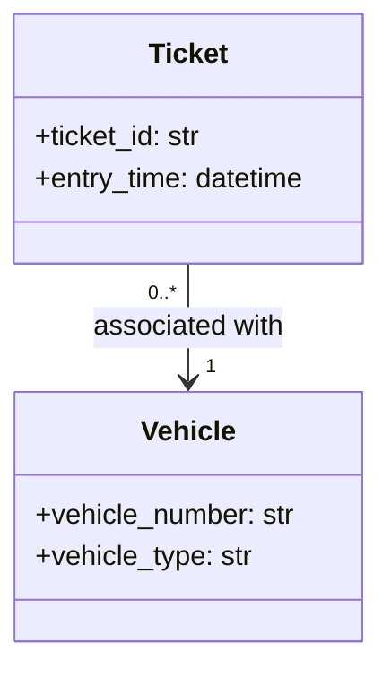
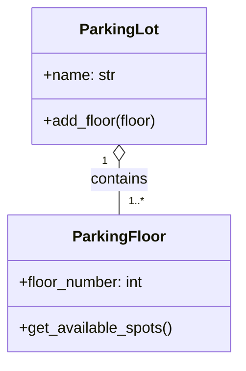
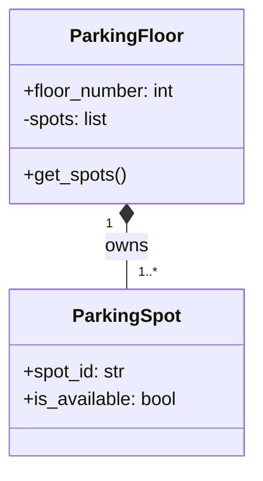
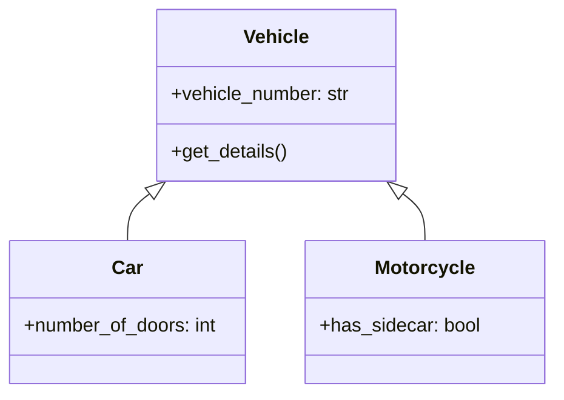
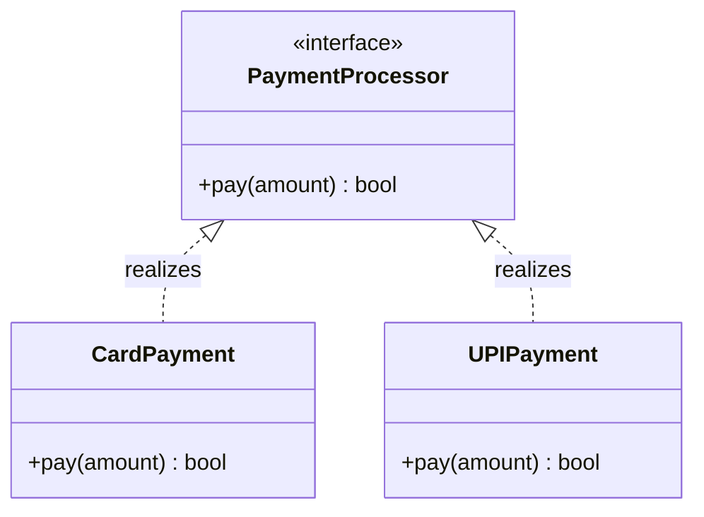
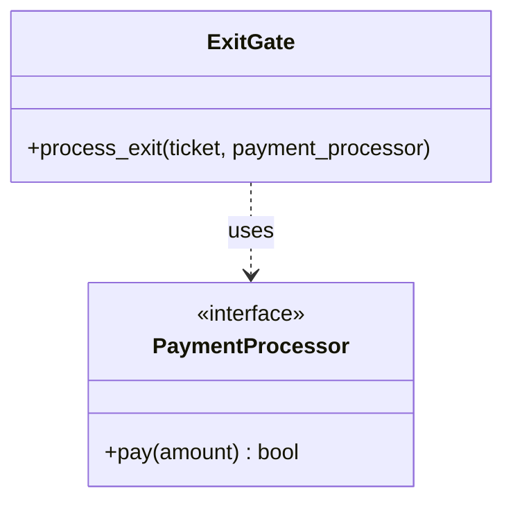
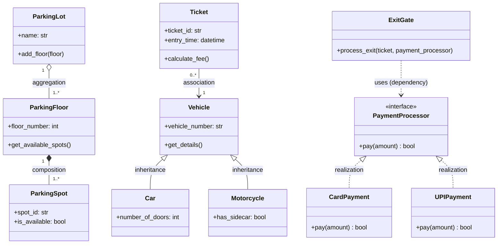
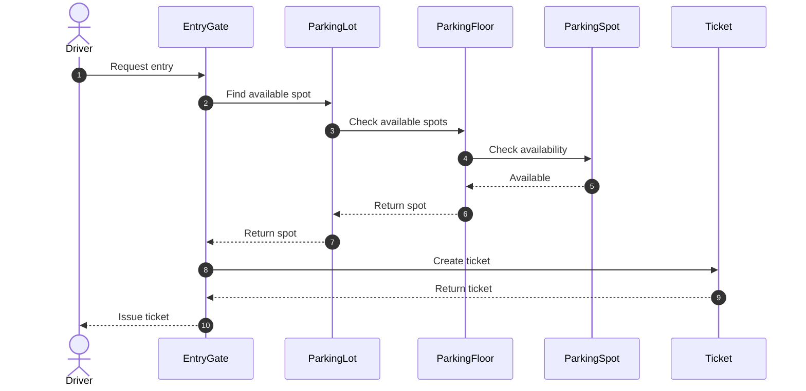
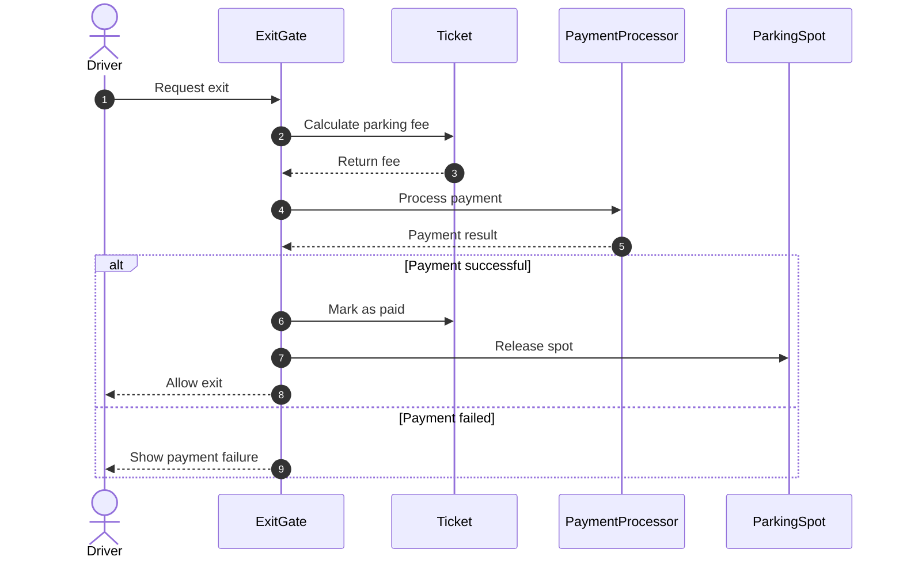

# Day 4: UML Class Diagrams and Relationships

Today, we will learn UML from the beginning using a **Parking Lot Management System**. We will cover all six UML relationships, their diagrams, Python code, real-world examples, and interview questions.

---

## 1. What is UML?

**UML (Unified Modeling Language)** is a standard visual modeling language used to represent the structure and behavior of a software system.

UML helps us understand a system before writing code.

For example, when designing a Parking Lot System, we need to identify:
- What classes are required?
- What data and methods does each class contain?
- How are the classes connected?
- How do objects communicate when a vehicle enters or exits?

There are two important diagram types for today's lesson:

- **Class Diagram**: Shows classes, attributes, methods, and relationships. It describes the system's structure.
- **Sequence Diagram**: Shows how objects communicate with each other in chronological order during an operation.

---

## 2. UML Class Diagram Notation

A UML class is usually drawn as a rectangle with three sections:

```text
+------------------------------------+
|              Vehicle               |
+------------------------------------+
| - vehicle_number: str              |
| - vehicle_type: str                |
+------------------------------------+
| + get_details(): str               |
+------------------------------------+
```

- **Top section**: Class name
- **Middle section**: Attributes
- **Bottom section**: Methods

### Common Visibility Symbols

| Symbol | Meaning | Example |
| :---: | :--- | :--- |
| `+` | Public | `+ get_details()` |
| `-` | Private | `- vehicle_number` |
| `#` | Protected | `# validate()` |

> **In Python:** These UML visibility conventions are not enforced strictly by the language runtime as in languages like Java. A leading underscore (`_`) is a common convention for non-public attributes, and double underscores (`__`) trigger name mangling.

---

## 3. The Six UML Relationships

We will use the Parking Lot System to understand:

1. **Association**
2. **Aggregation**
3. **Composition**
4. **Inheritance (Generalization)**
5. **Realization**
6. **Dependency**

The important difference is whether classes simply communicate, own other objects, inherit behavior, implement a contract, or temporarily use another class.

---

## 4. Association

### Definition
Association is a relationship in which two classes are connected and can interact with each other.  
Neither class necessarily owns the other, and both can exist independently.

### Example: Ticket and Vehicle
A parking ticket is associated with the vehicle that entered the parking lot.



### How to read this diagram
- One `Ticket` is associated with one `Vehicle`.
- A `Vehicle` can have multiple tickets over time (`0..*`).
- The ticket does not need to own the vehicle.
- Both objects can exist independently.

*(The multiplicities shown are one possible design for historical parking records.)*

### Python Implementation

```python
from dataclasses import dataclass
from datetime import datetime

@dataclass
class Vehicle:
    vehicle_number: str
    vehicle_type: str

@dataclass
class Ticket:
    ticket_id: str
    entry_time: datetime
    vehicle: Vehicle
```

### Usage

```python
vehicle = Vehicle("TN01AB1234", "Car")
ticket = Ticket(
    ticket_id="T101",
    entry_time=datetime.now(),
    vehicle=vehicle
)
print(ticket.vehicle.vehicle_number)
```

### Output
```text
TN01AB1234
```

Here, `Ticket` holds a reference to `Vehicle`. This is an example of association.

> **Interview point:** Association describes a relationship between objects. It does not, by itself, specify ownership or lifecycle dependency.

---

## 5. Aggregation

### Definition
Aggregation is a **weak whole-part relationship**. One object groups other objects, but the part objects can exist independently of the whole.

### Example: ParkingLot and ParkingFloor
A parking lot contains several floors. In this design, floors can be created independently and then added to a parking lot.



The hollow diamond (`o--`) represents aggregation. The diamond is placed on the whole side (`ParkingLot`).

### Python Implementation

```python
class ParkingFloor:
    def __init__(self, floor_number):
        self.floor_number = floor_number

    def get_available_spots(self):
        return []

class ParkingLot:
    def __init__(self, name):
        self.name = name
        self.floors = []

    def add_floor(self, floor):
        self.floors.append(floor)
```

### Usage

```python
floor1 = ParkingFloor(1)
floor2 = ParkingFloor(2)
lot = ParkingLot("Chennai Central Parking")
lot.add_floor(floor1)
lot.add_floor(floor2)
print(len(lot.floors))
```

### Output
```text
2
```

Notice that the floors are created outside `ParkingLot` and passed into it:

```text
Create ParkingFloor objects
           ↓
Create ParkingLot
           ↓
Add existing floors
```

This illustrates aggregation in our chosen model.

> **Important:** Python does not enforce aggregation as a special language feature. It is the ownership and lifecycle design that makes this an aggregation relationship.

---

## 6. Composition

### Definition
Composition is a **strong whole-part relationship** in which the whole controls the lifecycle of its parts. If the whole object is destroyed, its parts typically cease to exist.

In our example, we will model a parking floor as owning its parking spots.

### Example: ParkingFloor and ParkingSpot



The filled diamond (`*--`) represents composition. The diamond is placed on the owner side (`ParkingFloor`).

### Python Implementation

```python
class ParkingSpot:
    def __init__(self, spot_id):
        self.spot_id = spot_id
        self.is_available = True

class ParkingFloor:
    def __init__(self, floor_number, spot_ids):
        self.floor_number = floor_number
        # This floor creates and owns its spots.
        self._spots = [
            ParkingSpot(spot_id)
            for spot_id in spot_ids
        ]

    def get_spots(self):
        return list(self._spots)
```

### Usage

```python
floor = ParkingFloor(
    floor_number=1,
    spot_ids=["A1", "A2", "A3"]
)
for spot in floor.get_spots():
    print(spot.spot_id)
```

### Output
```text
A1
A2
A3
```

Here, the floor creates its own spots and controls how they are managed.

> **Important distinction:** Python objects are not automatically destroyed just because a parent reference disappears. Composition is a modeling and lifecycle concept, not automatic memory deletion.  
> Also, composition is a design choice, not a universal rule for parking systems. If spots must be managed independently, a different relationship may be more appropriate.

---

## 7. Inheritance (Generalization)

### Definition
Inheritance represents an **IS-A relationship**. A child class inherits or specializes the behavior of a parent class.

### Example: Vehicle, Car and Motorcycle



The hollow triangle points toward the parent class:
- A `Car` is a `Vehicle`.
- A `Motorcycle` is a `Vehicle`.
- Both can share common vehicle information.

### Python Implementation

```python
class Vehicle:
    def __init__(self, vehicle_number):
        self.vehicle_number = vehicle_number

    def get_details(self):
        return self.vehicle_number

class Car(Vehicle):
    def __init__(self, vehicle_number, number_of_doors):
        super().__init__(vehicle_number)
        self.number_of_doors = number_of_doors

class Motorcycle(Vehicle):
    def __init__(self, vehicle_number, has_sidecar=False):
        super().__init__(vehicle_number)
        self.has_sidecar = has_sidecar
```

### Usage

```python
car = Car("TN01AB1234", 4)
bike = Motorcycle("TN02CD5678")
print(car.get_details())
print(car.number_of_doors)
print(bike.get_details())
```

### Output
```text
TN01AB1234
4
TN02CD5678
```

The child classes reuse `Vehicle` behavior.

### When should you use inheritance?
- Use inheritance when the child is genuinely a subtype of the parent and can honor the parent's expected behavior.
- Do not use inheritance merely to reuse a few lines of code. Composition may be more appropriate if the relationship is **HAS-A** rather than **IS-A**.

---

## 8. Realization

### Definition
Realization represents a relationship in which a class implements a contract defined by an interface or specification.

For our example, the parking system needs a way to process payments. It should not depend on one specific payment implementation.

### UML Diagram



The dashed line with a hollow triangle (`<|..`) represents realization. The triangle points toward the interface.  
Both `CardPayment` and `UPIPayment` promise to implement the `pay()` operation.

### Python Implementation
Python does not have a Java-style `interface` keyword. We can express this contract using an abstract base class.

```python
from abc import ABC, abstractmethod

class PaymentProcessor(ABC):
    @abstractmethod
    def pay(self, amount: float) -> bool:
        pass

class CardPayment(PaymentProcessor):
    def pay(self, amount: float) -> bool:
        print(f"Processing card payment: ₹{amount}")
        return True

class UPIPayment(PaymentProcessor):
    def pay(self, amount: float) -> bool:
        print(f"Processing UPI payment: ₹{amount}")
        return True
```

### Usage

```python
payment = CardPayment()
payment.pay(100)
payment = UPIPayment()
payment.pay(100)
```

### Output
```text
Processing card payment: ₹100
Processing UPI payment: ₹100
```

The abstract class defines the contract. The concrete classes provide their own implementations.

> **Interview point:** Realization is different from inheritance of a concrete class. It specifically represents fulfilling a contract. In Python, an abstract base class can also provide shared implementation, so the distinction depends on the design being modeled.

---

## 9. Dependency

### Definition
Dependency is a relationship in which **one class uses another class** to perform an operation.  
The dependent class needs the other class, but it does not necessarily own it or store it permanently.

### Example: ExitGate depends on PaymentProcessor
When a vehicle exits, the gate needs a payment processor to collect the parking fee.



The dashed arrow (`..>`) represents dependency. The arrow points from the dependent class toward the class it uses.

### Python Implementation

```python
class ExitGate:
    def process_exit(self, ticket, payment_processor):
        amount = ticket.calculate_fee()
        if payment_processor.pay(amount):
            ticket.mark_paid()
            print("Exit approved")
        else:
            print("Payment failed")
```

The `ExitGate` receives `payment_processor` as a method argument. It uses the object to process payment without creating a specific payment implementation itself.  
*(For this example, assume `ticket` provides `calculate_fee()` and `mark_paid()` methods, and the payment processor implements `pay()`.)*

> **Interview point:** Dependency does not necessarily mean a permanent field reference. A method can depend on a class simply because it uses that class as a parameter or local variable.

---

## 10. Compare All Six UML Relationships

This is the most important revision table for interviews.

| Relationship | UML Notation | Meaning | Parking Lot Example |
| :--- | :---: | :--- | :--- |
| **Association** | `A --> B` | Objects are related | `Ticket → Vehicle` |
| **Aggregation** | `A o-- B` | Weak whole-part relationship | `ParkingLot ◇ ParkingFloor` |
| **Composition** | `A *-- B` | Strong whole-part ownership | `ParkingFloor ◆ ParkingSpot` |
| **Inheritance** | `A <\|-- B` | IS-A relationship | `Vehicle → Car` |
| **Realization** | `A <\|.. B` | Implements a contract | `PaymentProcessor → CardPayment` |
| **Dependency** | `A ..> B` | Uses another class | `ExitGate → PaymentProcessor` |

*(Note: Diagram direction depends on which class is the parent, interface, owner, or dependency. Read arrow and diamond positions carefully.)*

### A Quick Way to Remember

```text
Association → "These objects are connected."
Aggregation → "This object groups other objects."
Composition → "This object owns the lifecycle of its parts."
Inheritance → "This class is a type of another class."
Realization → "This class implements a contract."
Dependency  → "This class uses another class."
```

---

## 11. Complete Parking Lot Class Diagram

Now let's combine these relationships into one conceptual UML diagram:



> **Note:** This is a teaching model rather than a production-ready design. A complete implementation would also define how a spot is assigned to a vehicle, how ticket state is managed, and how payment failures are handled.

---

## 12. Sequence Diagram: Vehicle Entry

A class diagram shows the structure. A sequence diagram shows the order of interactions.



### Expected Flow
1. The driver requests entry.
2. The system searches for an available spot.
3. The selected spot is reserved or marked occupied.
4. A ticket is created with entry details.
5. The ticket is returned to the driver.

*(If no spot is available, the system should reject entry or report that the parking lot is full.)*

---

## 13. Sequence Diagram: Vehicle Exit and Payment



> **Important rule:** The spot should not be released merely because payment was attempted. The application must verify successful payment according to its business rules.

---

## 14. Interview Questions and Answers

### Q1. What is the difference between association and dependency?
**Answer:**  
Association generally represents a structural relationship between objects, often maintained as a reference or attribute. Dependency means one class uses another class temporarily, typically as a method parameter, return type, or local variable.

### Q2. What is the difference between aggregation and composition?
**Answer:**  
Aggregation models a weak whole-part relationship where parts can exist independently of the whole (`ParkingLot` and `ParkingFloor`). Composition models stronger ownership, where the whole controls the lifecycle of its parts; if the whole dies, the parts die too (`ParkingFloor` and `ParkingSpot`).

### Q3. What is the difference between inheritance and realization?
**Answer:**  
Inheritance represents an IS-A subtype relationship between classes, sharing or overriding implementation. Realization represents implementing an abstract contract or interface without necessarily inheriting concrete implementation.

### Q4. Can we implement an interface in Python?
**Answer:**  
Python has no dedicated `interface` keyword. We can use abstract base classes with `ABC` and `@abstractmethod`, or use `typing.Protocol` for structural typing (duck typing with static checking).

### Q5. Can a class have multiple dependencies?
**Answer:**  
Yes. A class can use multiple services or abstractions. However, having too many dependencies may indicate violating the Single Responsibility Principle (SRP) or tight coupling.

### Q6. Why should ExitGate depend on PaymentProcessor instead of directly depending on CardPayment?
**Answer:**  
Because it allows different payment implementations (Card, UPI, Wallet, etc.) to be supplied without modifying the `ExitGate` logic. This adheres to the Open/Closed Principle (OCP) and Dependency Inversion Principle (DIP).
